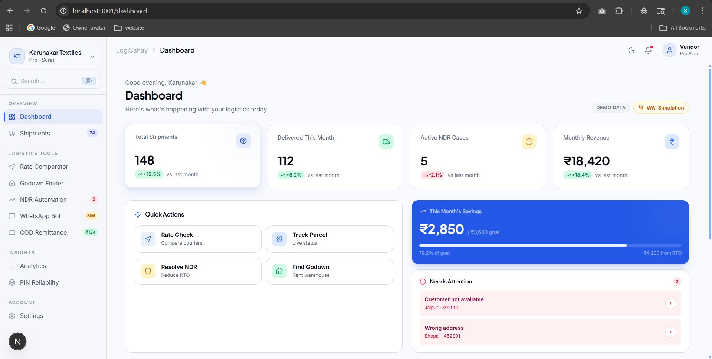
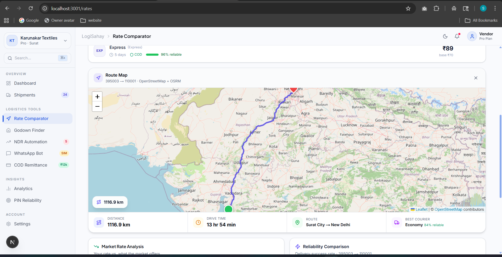
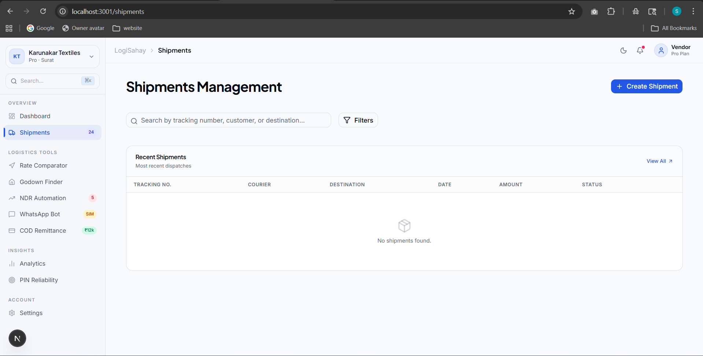
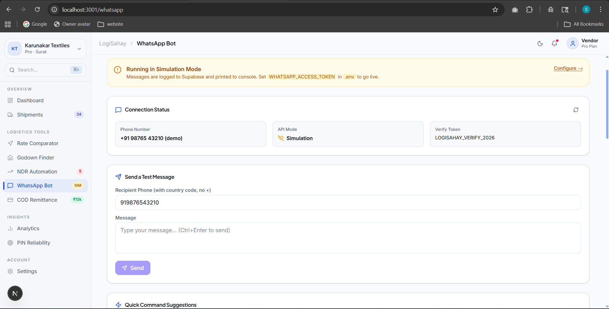



  <h1>🚚 LogiSahay</h1>
  
<strong>Logistics Intelligence & Route Optimization Platform for Indian Micro-Sellers</strong>

 

**LogiSahay** is a full-stack logistics management platform that empowers small and medium-sized Indian ecommerce businesses to track shipments, minimize Non-Delivery Reports (NDR), compare live courier rates efficiently, and negotiate better SLA terms through data-backed briefs.

---

## ✨ Features Preview & Walkthrough

To display the images below on GitHub or elsewhere, please save your screenshots inside the /docs folder at the root of your project using the filenames listed below.

### 1. 📊 Interactive Dashboard
A unified command center providing a single-pane-of-glass view into total shipments, revenue, proactive NDR alerts, and savings goals.

### 2. 💰 Rate Comparator & Export Negotiation Brief
Compare live rates across multiple carriers based on weight, pin codes, and COD support. Generate professional PDF negotiation briefs to leverage competitive market rates for contract discounts.

### 3. 🗺️ Geographical Route Mapping
Visually map delivery routes using geospatial data (OpenStreetMap + Leaflet integration) combined with calculated distances and estimated drive times.

### 4. 📦 Shipments Control Panel
Track the granular status of historical and active dispatched parcels seamlessly in a unified clean data table.

### 5. 🤖 Automated WhatsApp Bot (Simulation Mode)
Configure intelligent auto-responders and notifications for delivery delays. Operate in full simulation mode for risk-free testing prior to production.

---

## 🛠️ Technology Stack

### **Frontend (/frontend)**
* **Next.js 16.2** (App Router & Turbopack)
* **React 19**
* **Tailwind CSS + PostCSS** for utility styling
* **Zustand** for lightweight global state telemetry
* **Shadcn/UI & Radix** base primitives
* **Recharts & Leaflet.js** for charting and maps
* **jsPDF** for programmatic brief generation

### **Backend (/backend)**
* **FastAPI & Uvicorn** (Python 3.10+) 
* **Domain-Driven Design (Clean Architecture)**
* **Redis** caching for extreme metric dashboard performance
* **Supabase (PostgreSQL)** for user credentials, shipment, and NDR entity storage
* **Pydantic** for rigid payload validation

---

## 🚀 Getting Started

**1. Clone the repository:**
\\\ash
git clone https://github.com/yourusername/LogiSahay.git
cd LogiSahay
\\\

**2. Start the Backend Services:**
\\\ash
cd backend
python -m venv venv
# Windows: venv\Scripts\activate | Mac/Linux: source venv/bin/activate
pip install -r requirements.txt
uvicorn src.main:app --reload --host 0.0.0.0 --port 8000
\\\
*(Ensure you have setup your .env with Supabase and Redis credentials appropriately)*

**3. Start the Next.js Client:**
\\\ash
cd ../frontend
npm install
npm run dev
\\\
*The app will automatically point to the \localhost:8000\ API and execute locally on \http://localhost:3000\.*

---

## 🏗️ Architecture Note
This monolithic repository cleanly isolates frontend interfaces from backend domain logic. Please refer to [PROJECT_WALKTHROUGH.md](./PROJECT_WALKTHROUGH.md) for a comprehensive deep-dive into every API endpoint and backend use-case.
